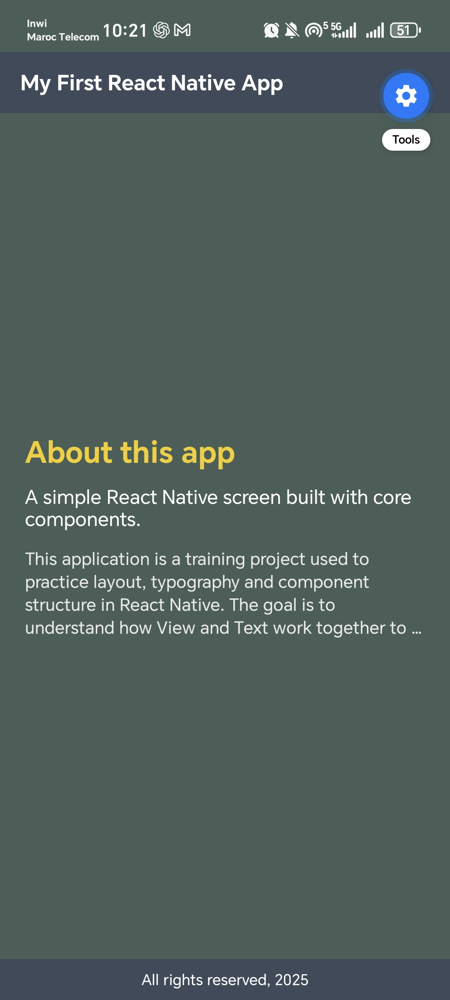
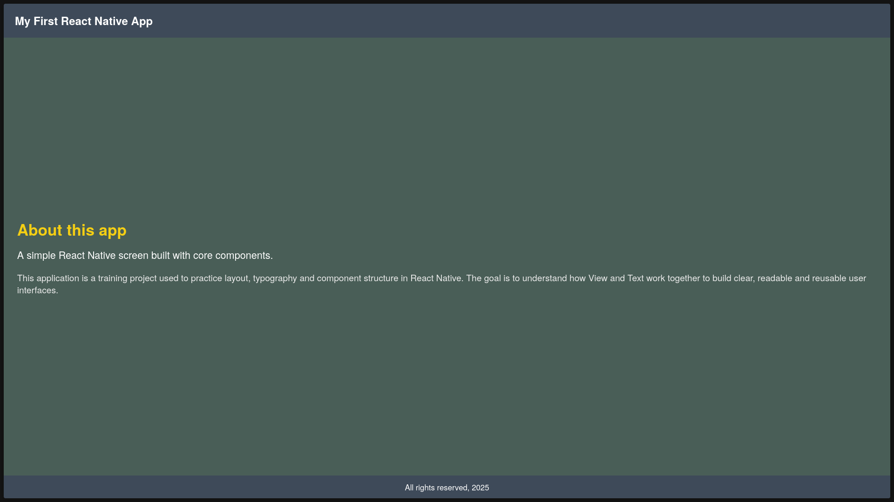

# Lab 2 — Construire un écran « About » avec View et Text

Sur Android avec Expo Go, le paragraphe est tronqué après quatre lignes. L’en-tête et le pied de page restent visibles.

Dans le navigateur, le paragraphe s’affiche en entier sur deux lignes grâce à la largeur de la fenêtre.

